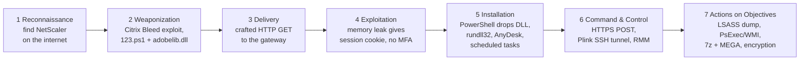

# Week 4 - The Cyber Kill Chain

Tasks from the syllabus: take a real attack, split it into the 7 stages of the Lockheed Martin Cyber Kill Chain and map every stage to MITRE ATT&CK.

## Which attack and why

I took **LockBit 3.0 affiliates exploiting Citrix Bleed (CVE-2023-4966)** from the CISA advisory [AA23-325A](https://www.cisa.gov/news-events/cybersecurity-advisories/aa23-325a). Reasons:

- LockBit is in the top of the groups that attack the financial sector (week 2 chart), and its IOCs from this advisory are already in our MISP (week 3, `week2/data/cisa/lockbit_AA23-325A.json`).
- The same wave of attacks hit a bank: on 8-9 November 2023 LockBit encrypted **ICBC Financial Services**, the US broker-dealer of the biggest bank in the world. The bank could not settle Treasury trades and had to send settlement data on a USB stick. Researchers pointed to an unpatched Citrix NetScaler as the likely entry point ([Dark Reading](https://www.darkreading.com/vulnerabilities-threats/citrixbleed-linked-to-ransomware-hit-on-china-s-state-owned-bank)). Official confirmation of the entry point was not published, so below I use the Boeing case from the CISA advisory, where all steps are documented.
- Banks in Kazakhstan also use NetScaler / VPN gateways for remote access, so this scenario is realistic for them.

## Kill Chain diagram

## The 7 stages

### 1. Reconnaissance
The attackers needed internet-facing NetScaler ADC / Gateway appliances with a vulnerable version. Citrix Bleed was exploited as a zero-day from August 2023 and the patch came out on 10 October 2023, so after that anyone could scan for unpatched gateways. The advisory does not describe how exactly targets were picked, so this stage is my analysis, not a reported fact.

### 2. Weaponization
- An exploit for CVE-2023-4966: one HTTP GET request with a very long `Host` header makes the appliance return a piece of its memory.
- A loader script `123.ps1`: two base64 strings that are glued together and decoded into `adobelib.dll`. The DLL only runs with a 104-character key, so a sandbox without the key sees nothing.

### 3. Delivery
No phishing. The request goes straight to the public NetScaler Gateway, the same address the bank's employees use for VPN.

### 4. Exploitation
The leaked memory contains a valid NetScaler AAA **session cookie**. The attacker puts it in the browser and is logged in as a real user, without a password and without MFA. After that the advisory lists `T1082` system discovery from the hijacked session.

### 5. Installation
- `123.ps1` writes `C:\Users\Public\adobelib.dll` and starts it with `rundll32 C:\Users\Public\adobelib.dll,main <key>`.
- Remote access tools are installed: AnyDesk (as an auto-start service), Splashtop, ScreenConnect renamed to `1.exe`/`m.exe`, Atera, TeamViewer and others.
- Persistence through scheduled tasks `UpdateAdobeTask` and `\MEGA\MEGAcmd`.

### 6. Command & Control
- `adobelib.dll` sends HTTPS POST requests to `adobe-us-updatefiles[.]digital` (Cloudflare IPs 172.67.129.176 and 104.21.1.180, I checked them in Shodan in week 2).
- Plink renamed to `servicehost.exe` opens a reverse SSH tunnel to 168.100.9.137.
- The RMM tools themselves are also a C2 channel.

### 7. Actions on Objectives
- Credentials: Mimikatz, LSASS dump to `c:\perflogs\lsass.dmp`, SAM/SYSTEM hives saved by `a.bat`, `veeam-get-creds.ps1` for backup passwords.
- Lateral movement with PsExec and `wmiexec`.
- Data is packed with 7-Zip and taken out through MEGA, FTP and temp.sh.
- Before encryption `taskkill /f` stops SQL Server processes so the databases can be encrypted. Then LockBit encrypts the files.

For a bank this last stage means stolen client data plus stopped core systems, which is exactly what happened at ICBC.

## MITRE ATT&CK mapping

Techniques marked * are in the CISA ATT&CK tables. The others come from the advisory text or from my analysis.

| Kill Chain stage | ATT&CK tactic | Technique | ID |
|---|---|---|---|
| Reconnaissance | Reconnaissance | Active Scanning: Vulnerability Scanning (my analysis) | [T1595.002](https://attack.mitre.org/techniques/T1595/002/) |
| Weaponization | Resource Development | Obtain Capabilities: Exploits | [T1588.005](https://attack.mitre.org/techniques/T1588/005/) |
| Weaponization | Resource Development | Develop Capabilities: Malware | [T1587.001](https://attack.mitre.org/techniques/T1587/001/) |
| Delivery / Exploitation | Initial Access | Exploit Public-Facing Application | [T1190](https://attack.mitre.org/techniques/T1190/) |
| Exploitation | Credential Access | Steal Web Session Cookie * | [T1539](https://attack.mitre.org/techniques/T1539/) |
| Exploitation | Credential Access | Modify Authentication Process: MFA * | [T1556.006](https://attack.mitre.org/techniques/T1556/006/) |
| Exploitation | Lateral Movement | Remote Service Session Hijacking | [T1563](https://attack.mitre.org/techniques/T1563/) |
| Exploitation | Discovery | System Information Discovery * | [T1082](https://attack.mitre.org/techniques/T1082/) |
| Installation | Execution | Command and Scripting Interpreter: PowerShell | [T1059.001](https://attack.mitre.org/techniques/T1059/001/) |
| Installation | Defense Evasion | Deobfuscate/Decode Files or Information | [T1140](https://attack.mitre.org/techniques/T1140/) |
| Installation | Defense Evasion | System Binary Proxy Execution: Rundll32 | [T1218.011](https://attack.mitre.org/techniques/T1218/011/) |
| Installation | Persistence | Scheduled Task/Job: Scheduled Task | [T1053.005](https://attack.mitre.org/techniques/T1053/005/) |
| Installation | Persistence | Create or Modify System Process: Windows Service | [T1543.003](https://attack.mitre.org/techniques/T1543/003/) |
| Command & Control | Command and Control | Application Layer Protocol: Web Protocols | [T1071.001](https://attack.mitre.org/techniques/T1071/001/) |
| Command & Control | Command and Control | Protocol Tunneling | [T1572](https://attack.mitre.org/techniques/T1572/) |
| Command & Control | Command and Control | Remote Access Tools | [T1219](https://attack.mitre.org/techniques/T1219/) |
| Actions on Objectives | Credential Access | OS Credential Dumping: LSASS Memory | [T1003.001](https://attack.mitre.org/techniques/T1003/001/) |
| Actions on Objectives | Credential Access | OS Credential Dumping: Security Account Manager | [T1003.002](https://attack.mitre.org/techniques/T1003/002/) |
| Actions on Objectives | Execution | System Services: Service Execution (PsExec) | [T1569.002](https://attack.mitre.org/techniques/T1569/002/) |
| Actions on Objectives | Execution | Windows Management Instrumentation (wmiexec) | [T1047](https://attack.mitre.org/techniques/T1047/) |
| Actions on Objectives | Collection | Archive Collected Data: Archive via Utility | [T1560.001](https://attack.mitre.org/techniques/T1560/001/) |
| Actions on Objectives | Exfiltration | Exfiltration Over Web Service: to Cloud Storage | [T1567.002](https://attack.mitre.org/techniques/T1567/002/) |
| Actions on Objectives | Impact | Service Stop | [T1489](https://attack.mitre.org/techniques/T1489/) |
| Actions on Objectives | Impact | Data Encrypted for Impact | [T1486](https://attack.mitre.org/techniques/T1486/) |

## Where a bank could break the chain

| Stage | What would stop it |
|---|---|
| Reconnaissance / Exploitation | Patch internet-facing gateways in 24-48 hours (CVE-2023-4966 is in CISA KEV), kill all sessions after patching |
| Exploitation | Alert when one VPN session is used from two or more public IPs |
| Installation | Allowlist for RMM tools, PowerShell Script Block Logging, alert on `rundll32` loading a DLL from `C:\Users\Public` |
| C2 | Block new domains and outbound SSH from servers |
| Actions on Objectives | LSASS protection, offline backups, alert on mass `taskkill` of SQL processes |

The earlier the chain is broken, the cheaper it is. Stopping it at stage 4 means no encryption at all, and at stage 7 it is already an incident.

## What I learned from the Lockheed Martin paper

- The Kill Chain is a model for the defender: the attacker has to pass all 7 stages, and the defender only needs to break one.
- Intrusions should be linked into campaigns by the same indicators and TTPs. Here the same LockBit TTPs (Citrix Bleed, AnyDesk, `123.ps1`) connect Boeing, ICBC and other victims.
- Kill Chain stages are linear but ATT&CK tactics are not. For example T1539 and T1563 are both "Exploitation" for me, but in ATT&CK they are Credential Access and Lateral Movement.

## References

1. Lockheed Martin, [Intelligence-Driven Computer Network Defense Informed by Analysis of Adversary Campaigns and Intrusion Kill Chains](https://www.lockheedmartin.com/content/dam/lockheed-martin/rms/documents/cyber/LM-White-Paper-Intel-Driven-Defense.pdf).
2. CISA, [AA23-325A: LockBit 3.0 Ransomware Affiliates Exploit CVE 2023-4966 Citrix Bleed Vulnerability](https://www.cisa.gov/news-events/cybersecurity-advisories/aa23-325a).
3. Dark Reading, [CitrixBleed Linked to Ransomware Hit on China's State-Owned Bank](https://www.darkreading.com/vulnerabilities-threats/citrixbleed-linked-to-ransomware-hit-on-china-s-state-owned-bank).
4. MITRE ATT&CK, [LockBit 3.0 (S1202)](https://attack.mitre.org/software/S1202/).
